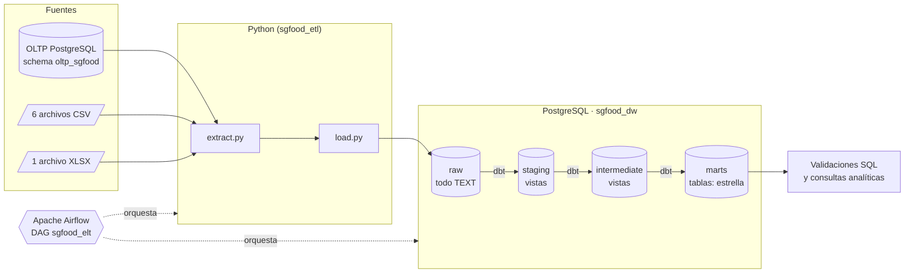
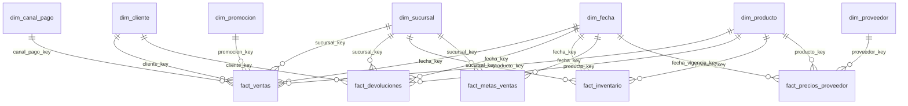
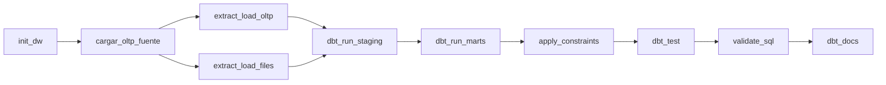

# SG-Food — Flujo moderno de datos con Python, Apache Airflow, dbt y PostgreSQL

**Curso:** Seminario de Sistemas 2 · **Repositorio:** `SS22S2026_grupo21` · **Carpeta:** `proyectos/proyecto1`

**Integrantes:**
- Integrante 1: _(Giovanni Saul Concohá Cax y 202100229)_
- Integrante 2: _(Melvin Alexander Valencia Estrada y 202111556)_

---

## Índice

1. [Contexto y objetivo](#1-contexto-y-objetivo)
2. [Arquitectura de la solución](#2-arquitectura-de-la-solución)
3. [Tecnologías](#3-tecnologías)
4. [Estructura del repositorio](#4-estructura-del-repositorio)
5. [Capas del Data Warehouse](#5-capas-del-data-warehouse)
6. [Modelo dimensional](#6-modelo-dimensional)
7. [Convención NULL vs VACÍO](#7-convención-null-vs-vacío)
8. [Extracción y carga con Python](#8-extracción-y-carga-con-python)
9. [Transformación con dbt](#9-transformación-con-dbt)
10. [Manual de ejecución paso a paso (con evidencias)](#10-manual-de-ejecución-paso-a-paso-con-evidencias)
11. [Orquestación con Apache Airflow](#11-orquestación-con-apache-airflow)
12. [Resultados obtenidos](#12-resultados-obtenidos)
13. [Problemas encontrados y solución](#13-problemas-encontrados-y-solución)
14. [Cómo extender el proyecto](#14-cómo-extender-el-proyecto)

---

## 1. Contexto y objetivo

**SG-Food** es una empresa dedicada a la **distribución y comercialización** de productos alimenticios.
Hoy depende de procesos manuales y de consultar directamente su base transaccional (OLTP), lo que hace
lento y poco confiable el análisis de ventas e inventarios.

El proyecto implementa un **flujo moderno de datos** que resuelve la necesidad de **automatizar la extracción
desde una fuente transaccional** y convertir esos datos crudos en **modelos analíticos confiables**.
Para lograrlo se construye una **arquitectura reproducible** que:

- **integra** datos crudos de varias fuentes (base de datos OLTP, archivos CSV y un Excel);
- **construye** dimensiones y hechos (modelo dimensional);
- **ejecuta** pruebas de calidad sobre los datos transformados;
- **facilita** consultas analíticas de ventas, inventario, metas, devoluciones y costos de proveedores.

Componentes principales:

| Componente | Responsabilidad |
|---|---|
| **Python** | Proceso de **extracción y carga** (E y L) de las fuentes al schema `raw`. |
| **Apache Airflow** | **Orquestación** del pipeline: tareas de carga, ejecución de dbt y validaciones. |
| **PostgreSQL** | **Data Warehouse** con modelo dimensional (hechos y dimensiones). |
| **dbt Core** | **Modelos analíticos** (T): capas `staging`, `intermediate` y `marts`, más pruebas. |

---

## 2. Arquitectura de la solución

Se aplica un enfoque **ELT** (Extract → Load → Transform): primero se carga el dato tal como viene de la fuente
y después se transforma **dentro** del Data Warehouse con dbt.



**¿Por qué ELT y no ETL?**
- El dato original queda **auditable** en `raw` (trazable por lote con `_batch_id`, `_loaded_at`, `_source_file`).
- Las transformaciones son **SQL versionado y probado** (dbt).
- Si cambia una regla de negocio se reconstruye todo **sin volver a leer las fuentes**.

---

## 3. Tecnologías

| Herramienta | Versión utilizada |
|---|---|
| PostgreSQL (Docker, imagen `postgres:16`) | 16.15 |
| Python | 3.10+ (entorno virtual `.venv`) |
| dbt-core / dbt-postgres | 1.12.5 / 1.11.0 |
| psycopg2-binary, python-dotenv, openpyxl | ver `requirements.txt` |
| Apache Airflow (imagen `apache/airflow`) | 3.3.2 |
| Docker / Docker Compose | — |
| TablePlus (cliente gráfico para revisar la BD) | 1.6.0 |

---

## 4. Estructura del repositorio

```
proyecto1/
├── .env                         Credenciales y parámetros (NO se versiona; ver .gitignore)
├── .gitignore
├── docker-compose.yml           Servicio PostgreSQL del Data Warehouse (sgfood-postgres)
├── Makefile                     Atajos: init, oltp, extract-load, dbt-build, constraints, validate, docs
├── requirements.txt             Dependencias de Python (incluye dbt)
├── pasos.md                     Bitácora de comandos ejecutados
├── data/
│   ├── oltp/sgfood_oltp.sql     Script de la base transaccional (fuente)
│   └── files/                   Fuentes planas: 6 CSV + 1 XLSX
├── src/sgfood_etl/              PAQUETE PYTHON (Extract + Load)
│   ├── config.py                Lee .env y expone la configuración tipada
│   ├── db.py                    Único módulo que abre conexiones y ejecuta .sql
│   ├── registry.py              Catálogo: qué tabla/archivo va a qué tabla raw
│   ├── extract.py               Lectura de OLTP / CSV / XLSX en lotes de texto
│   ├── load.py                  TRUNCATE + INSERT atómico en raw
│   ├── pipeline.py              Funciones de alto nivel (las usa la CLI y Airflow)
│   └── __main__.py              CLI: python -m sgfood_etl <comando>
├── scripts/
│   └── run_dbt.sh               Ejecuta dbt exportando las variables del .env
├── sql/
│   ├── ddl/
│   │   ├── 01_schemas.sql       Crea raw / staging / intermediate / marts
│   │   ├── 02_raw_tables.sql    14 tablas raw (todo TEXT) — fuente de verdad del cargador
│   │   ├── 03_constraints_dw.sql PK y FK del modelo estrella (idempotente)
│   │   └── 04_marts_reference_ddl.sql DDL de referencia de marts (pg_dump, solo documentación)
│   └── validation/
│       ├── 01_conteos_raw_vs_marts.sql
│       ├── 02_integridad_referencial.sql
│       └── 03_llaves_no_resueltas.sql
├── dbt/sgfood_dw/               PROYECTO dbt
│   ├── dbt_project.yml          Materialización por capa y rango de dim_fecha
│   ├── profiles.yml             Conexión vía variables de entorno (sin credenciales)
│   ├── macros/                  generate_schema_name, data_quality (casts seguros, NULL/VACÍO)
│   ├── models/
│   │   ├── staging/             sources.yml + 12 modelos stg_*
│   │   ├── intermediate/        4 modelos int_*
│   │   └── marts/               dimensions/ (7) · facts/ (5) · analytics/ (2)
│   └── tests/                   11 pruebas singulares + 1 prueba genérica propia
├── airflow/
│   ├── docker-compose.airflow.yml  Servicios de Airflow (se combina con docker-compose.yml)
│   └── main/
│       ├── Dockerfile           Imagen apache/airflow:3.3.2 + dependencias + dbt aislado
│       ├── dags/sgfood_elt_dag.py  DAG del pipeline
│       ├── auth/passwords.json  Contraseña del usuario admin de la interfaz
│       └── artifacts/           Salidas de dbt generadas desde Airflow
└── Documentacion/
    ├── README.md                Este documento
    ├── Planeacion/              Notas de diseño (fotografías)
    └── img/                     Capturas de pantalla de la ejecución
```

---

## 5. Capas del Data Warehouse

El Data Warehouse vive en PostgreSQL (base `sgfood_dw`) y se divide en **schemas**, uno por etapa:

| Schema | Qué contiene | Quién lo construye | Materialización |
|---|---|---|---|
| `raw` | Datos **tal como vinieron de la fuente**. Todas las columnas son `TEXT`, sin PK/FK, con columnas de control `_batch_id`, `_loaded_at`, `_source_file`. | Python | tablas |
| `staging` | **Aquí se empieza a limpiar**: tipado seguro, `trim`, normalización, distinción NULL/VACÍO y banderas de calidad `dq_*`. No borra filas. | dbt | vistas |
| `intermediate` | **Zona de preparación**: une varias tablas y aplica reglas de negocio reutilizables antes de crear el modelo dimensional. | dbt | vistas |
| `marts` | **Aquí vive el Data Warehouse analítico**: dimensiones, hechos y marts analíticos. | dbt | tablas |

Se usa `view` en staging/intermediate porque son baratas y siempre reflejan `raw`; los marts son `table`
para que las consultas analíticas sean rápidas. Como `raw` se recarga completo en cada corrida, no se usan
modelos incrementales.

---

## 6. Modelo dimensional

Se aplica un **esquema en estrella** (Kimball):

- **Tablas de hechos** → eventos **medibles** (cantidades, montos, stock, metas, costos).
- **Tablas de dimensiones** → el **contexto**: quién, qué, dónde y cuándo.

### 6.1 Tablas de hechos

| Hecho | Grano (qué representa una fila) | Medidas principales | Dimensiones |
|---|---|---|---|
| `fact_ventas` | una **línea de venta** | cantidad, monto_bruto, monto_descuento, monto_neto, costo_estimado, margen_estimado | fecha, cliente, sucursal, producto, canal_pago, promoción |
| `fact_devoluciones` | una **devolución** | cantidad, cantidad_vendida, monto_devuelto_estimado | fecha, producto, sucursal, cliente |
| `fact_inventario` | **fecha de corte × sucursal × producto** (snapshot) | stock_disponible, stock_minimo, stock_maximo | fecha, sucursal, producto |
| `fact_metas_ventas` | **mes × sucursal** | meta_ventas, meta_unidades | fecha, sucursal |
| `fact_precios_proveedor` | **proveedor × producto × vigencia** | costo_proveedor, plazo_dias | proveedor, producto, fecha |

### 6.2 Dimensiones

| Dimensión | Descripción |
|---|---|
| `dim_fecha` | Calendario diario en español (2024-01-01 a 2027-12-31). Llave `YYYYMMDD`. |
| `dim_sucursal` | Sucursales con ciudad y departamento. |
| `dim_producto` | Producto con **categoría y marca desnormalizadas**, costo base, precio de lista y margen. |
| `dim_cliente` | Clientes (NIT, tipo de cliente, municipio). |
| `dim_proveedor` | Proveedores obtenidos del CSV de precios. |
| `dim_canal_pago` | Dimensión *junk*: combinación de canal × método de pago. |
| `dim_promocion` | Promociones por categoría con vigencia y porcentaje de descuento. |

### 6.3 Marts analíticos

| Mart | Uso |
|---|---|
| `mart_cumplimiento_metas` | Meta vs. venta real por mes y sucursal (brecha y % de cumplimiento en ventas y unidades). |
| `audit_calidad_datos` | Una fila por regla de calidad: cuántos registros la incumplen y su porcentaje. Las reglas coinciden con las incidencias de `casos_calidad_opcionales.csv`. |

### 6.4 Diagrama del modelo estrella

Diseño original (notas de planeación):


Modelo implementado:



### 6.5 Decisiones de diseño

1. **Grano explícito** en cada hecho. `fact_ventas` está a nivel de **línea** (no de venta completa) para analizar por producto sin perder detalle; `id_venta` queda como dimensión degenerada.
2. **Estrella y no copo de nieve:** categoría y marca viven dentro de `dim_producto` (menos joins).
3. **Llaves:** las dimensiones de negocio usan el id de origen como llave (`producto_key = id_producto`), SCD tipo 1. `dim_fecha` usa `YYYYMMDD`; `dim_canal_pago`, `fact_inventario`, `fact_metas_ventas` y `fact_precios_proveedor` usan llave sustituta (`row_number`).
4. **Miembro `-1 "NO DEFINIDO"`** en cada dimensión: un registro huérfano no se pierde ni rompe la FK; apunta a `-1` y se reporta en las validaciones.
5. **Ventas `ANULADA`/`PENDIENTE` se conservan** con `estado_venta`; los ingresos se calculan con `es_venta_efectiva = true`.
6. **Promoción aplicada** a una línea: misma categoría del producto y fecha dentro de la vigencia; si aplican varias gana la de mayor descuento.
7. **Inventario como snapshot**: sus medidas son semi-aditivas (se suman entre sucursales, no entre fechas).
8. **PK y FK al final** (`make constraints`): dbt recrea las tablas de `marts` en cada corrida y se perderían las restricciones, por eso se agregan después, con un script idempotente.

---

## 7. Convención NULL vs VACÍO

Requisito del proyecto: distinguir un dato **ausente** de un campo **presente pero vacío**.

| Concepto | Significado | Cómo llega a `raw` |
|---|---|---|
| **NULL** | dato ausente | CSV: el campo contiene un token de `NULL_TOKENS` (`NULL`, `null`, `\N`, `NaN`, `None`) · XLSX: celda vacía · OLTP: `NULL` de la base |
| **VACÍO** | campo presente con `""` | se guarda como cadena vacía |

En dbt se conserva la diferencia con dos macros (`macros/data_quality.sql`):

- `estado_dato(col)` → devuelve `NULO`, `VACIO` u `OK` (por ejemplo `costo_proveedor_estado`).
- `clean_text(col)` → etiqueta distinta para cada caso: `NO_INFORMADO` (NULL) y `SIN_VALOR` (vacío).

En `audit_calidad_datos` existen reglas separadas **«Costo nulo»** y **«Costo vacío»**. Los tokens de NULL se
pueden cambiar con la variable `NULL_TOKENS` del `.env`.

---

## 8. Extracción y carga con Python

El paquete `src/sgfood_etl` implementa la **E** y la **L** del flujo. No aplica reglas de negocio.

| Módulo | Responsabilidad |
|---|---|
| `config.py` | Única fuente de configuración. Lee `.env` (las variables reales del entorno tienen prioridad, así Docker/Airflow pueden sobreescribirlas). |
| `db.py` | Único punto que abre conexiones (`dw` o `src`) y ejecuta archivos `.sql`. |
| `registry.py` | Catálogo de las 7 tablas OLTP y los 7 archivos con su tabla destino en `raw`. |
| `extract.py` | Lee el OLTP con cursor del lado del servidor; lee CSV (UTF-8 con/sin BOM) y XLSX; normaliza encabezados; aplica la regla NULL/VACÍO; entrega lotes de 5 000 filas. |
| `load.py` | `TRUNCATE + INSERT` dentro de **una transacción** por tabla (si falla, la tabla conserva su carga anterior) y estampa `_batch_id` y `_source_file`. |
| `pipeline.py` | Funciones de alto nivel: `init_warehouse`, `load_oltp_source`, `extract_load_oltp`, `extract_load_files`, `extract_load_all`, `apply_constraints`, `validate`. |
| `__main__.py` | CLI: `PYTHONPATH=src python -m sgfood_etl <comando>`. |

**Fuentes → tablas `raw`:**

| Fuente | Tabla raw |
|---|---|
| OLTP `sucursal`, `categoria`, `marca`, `producto`, `cliente`, `venta`, `venta_detalle` | `raw.oltp_<tabla>` |
| `inventario_bodega.csv` | `raw.csv_inventario_bodega` |
| `proveedores_precios.csv` | `raw.csv_proveedores_precios` |
| `promociones.csv` | `raw.csv_promociones` |
| `metas_ventas.csv` | `raw.csv_metas_ventas` |
| `devoluciones.csv` | `raw.csv_devoluciones` |
| `casos_calidad_opcionales.csv` | `raw.csv_casos_calidad` |
| `catalogo_insumos_sgfood.xlsx` | `raw.xlsx_catalogo_insumos` |

**Aislamiento de la conexión:** las credenciales están solo en `.env`. Python (`config.py`) y dbt
(`profiles.yml` con `env_var`) leen las mismas variables:

| Variable | Uso |
|---|---|
| `DW_HOST`, `DW_PORT`, `DW_SSLMODE` | Servidor del Data Warehouse |
| `POSTGRES_DB`, `POSTGRES_USER`, `POSTGRES_PASSWORD` | Base, usuario y contraseña (también los usa el contenedor de PostgreSQL) |
| `SRC_HOST`, `SRC_PORT`, `SRC_DB`, `SRC_USER`, `SRC_PASSWORD`, `SRC_SSLMODE` | Fuente OLTP; si se dejan vacías se heredan del DW |
| `SRC_SCHEMA` | Schema del OLTP en la fuente (`oltp_sgfood`) |
| `FILES_DIR`, `OLTP_SQL_FILE`, `CSV_DELIMITER`, `NULL_TOKENS` | Opcionales (tienen valores por defecto) |

Para apuntar a otro servidor (otro Docker o la nube) solo se edita `.env`.

---

## 9. Transformación con dbt

> *Python movió la información; dbt la convierte en información analítica.*

### 9.1 Modelos

| Capa | Modelos | Qué hacen |
|---|---|---|
| `staging` | `stg_oltp__sucursal`, `stg_oltp__categoria`, `stg_oltp__marca`, `stg_oltp__producto`, `stg_oltp__cliente`, `stg_oltp__venta`, `stg_oltp__venta_detalle`, `stg_csv__inventario_bodega`, `stg_csv__proveedores_precios`, `stg_csv__promociones`, `stg_csv__metas_ventas`, `stg_csv__devoluciones` | Un modelo por tabla fuente. Casts seguros (`safe_int`, `safe_numeric`, `safe_date`, `safe_bool`): un valor inválido se vuelve NULL y queda marcado en una bandera `dq_*`. |
| `intermediate` | `int_ventas_detalle_enriquecido` | Une detalle + encabezado + producto y calcula montos, costo y margen. |
| | `int_devoluciones_validadas` | Cruza cada devolución con lo vendido: `existe_venta_producto`, `excede_vendido`, precio neto unitario. |
| | `int_ventas_promocion` | Determina la promoción aplicable a cada línea de venta. |
| | `int_ventas_por_sucursal_mes` | Ventas reales (solo `COMPLETADA`) por sucursal y mes. |
| `marts` | 7 `dim_*`, 5 `fact_*`, `mart_cumplimiento_metas`, `audit_calidad_datos` | Modelo estrella y marts analíticos. |

Macros propias:
- `generate_schema_name`: usa el nombre de schema limpio (`staging`, `marts`…) en lugar de `staging_staging`.
- `data_quality`: `estado_dato`, `clean_text` y los casts seguros.

### 9.2 Pruebas

Las pruebas **demuestran que los datos transformados son válidos**. `dbt build` ejecuta **104 pruebas** junto a los 30 modelos:

- **Genéricas:** `unique` y `not_null` en cada llave, `relationships` hecho → dimensión, `accepted_values`
  (estado de venta, estado NULO/VACIO/OK) y la prueba propia `unique_combination_of_columns` para validar el grano.
- **Singulares** (`tests/`):

| Prueba | Severidad | Qué verifica |
|---|---|---|
| `assert_fact_ventas_conserva_filas_raw` | error | `fact_ventas` tiene las mismas filas que `raw.oltp_venta_detalle` |
| `assert_fact_ventas_monto_neto_suma_raw` | error | Σ `monto_neto` = Σ `subtotal` en raw (tolerancia 0.01) |
| `assert_ventas_con_fecha_en_dim_fecha` | error | Ninguna venta queda con `fecha_key = -1` |
| `assert_descuento_en_rango` | error | Descuentos dentro de [0, 1] |
| `assert_ventas_sin_cliente_huerfano` | warn | Líneas con cliente inexistente |
| `assert_subtotal_consistente` | warn | `subtotal = cantidad × precio × (1 − descuento)` |
| `assert_devoluciones_no_exceden_venta` | warn | Devoluciones sin venta o mayores a lo vendido |
| `assert_stock_no_negativo` | warn | Stock disponible negativo |
| `assert_inventario_vencimiento_posterior_al_corte` | warn | Lotes vencidos antes de la fecha de corte |
| `assert_metas_mayores_a_cero` | warn | Metas en cero |
| `assert_costo_proveedor_completo` | warn | Precios de proveedor sin costo |

Criterio: **error** para la integridad del modelo (detiene el pipeline) y **warn** para problemas de calidad de
la fuente (se reportan pero no detienen el flujo).

---

## 10. Manual de ejecución paso a paso (con evidencias)

Este es el orden planificado para construir el flujo (notas de planeación):

.jpeg)
.jpeg)

### Requisitos previos

- Docker y Docker Compose
- Python 3.10+ y `make`
- Archivo `.env` en la raíz de `proyecto1` con las variables de la [sección 8](#8-extracción-y-carga-con-python)

```bash
cd proyectos/proyecto1
python3 -m venv .venv
source .venv/bin/activate
pip install -r requirements.txt
```

Resumen de comandos:

| # | Comando | Qué hace |
|---|---|---|
| A | `docker compose up -d` | Levanta PostgreSQL (`sgfood-postgres`) |
| A | `make init` | Crea schemas y tablas raw (`01_schemas.sql`, `02_raw_tables.sql`) |
| B | `make oltp` | *(solo desarrollo)* Instala `sgfood_oltp.sql` en el schema `oltp_sgfood` |
| C | `make extract-load` | Python: OLTP + CSV + XLSX → `raw.*` |
| D | `make dbt-build` | dbt: staging → intermediate → marts + todas las pruebas |
| E | `make constraints` | Agrega PK/FK al modelo estrella |
| F | `make validate` | Validaciones SQL (conteos, integridad, llaves no resueltas) |
| G | `make docs` | Documentación de dbt con linaje en http://localhost:8080 |

Sin `make`: `PYTHONPATH=src python -m sgfood_etl <init-dw | load-oltp-source | extract-load | apply-constraints | validate>`
y `bash scripts/run_dbt.sh build`.

---

### A) Levantar la base de datos y crear los schemas

**1. Levantar el contenedor**

```bash
docker compose up -d
```

Crea la red `proyecto1_default`, el volumen `proyecto1_postgres_data` y el contenedor `sgfood-postgres`
(PostgreSQL 16, puerto 5432). Toma `POSTGRES_DB`, `POSTGRES_USER` y `POSTGRES_PASSWORD` del `.env`.

**2. Verificar que la base existe y está vacía**

```bash
docker exec -it sgfood-postgres psql -U sgfood -d sgfood_dw
```

La base `sgfood_dw` existe y `\dt` confirma que todavía no tiene relaciones:


También se configuró una conexión en TablePlus (`localhost:5432`, usuario `sgfood`, base `sgfood_dw`) para
revisar visualmente cada capa:


**3. Crear schemas y tablas raw**

```bash
make init
```

Ejecuta `pipeline.init_warehouse`, que corre `01_schemas.sql` y `02_raw_tables.sql`:


> El primer intento muestra `ImportError: cannot import name 'extract'`; se corrigió el paquete y la segunda
> ejecución terminó correctamente (ver [sección 13](#13-problemas-encontrados-y-solución)).

Resultado: aparecen los schemas `raw`, `staging`, `intermediate` y `marts`, y las 14 tablas de `raw`, aún vacías.


---

### B) Instalar la base transaccional (OLTP)

**OLTP** (*OnLine Transaction Processing*) es la base de datos operativa del negocio, la que usaría la empresa
en su día a día. En un entorno real ya existe; aquí se instala para poder extraer de ella.

```bash
make oltp
```

Ejecuta `pipeline.load_oltp_source`, que corre `data/oltp/sgfood_oltp.sql` en el schema `oltp_sgfood`:


El schema `oltp_sgfood` queda con sus 7 tablas (`categoria`, `cliente`, `marca`, `producto`, `sucursal`,
`venta`, `venta_detalle`). Por ejemplo, `cliente` tiene 250 filas:


---

### C) Extracción y carga a `raw`

```bash
make extract-load
```

Ejecuta `pipeline.extract_load_all`: carga primero las tablas OLTP y luego los archivos, todos con el mismo
`batch_id` (timestamp UTC de la corrida).

En el primer intento las 7 tablas OLTP y los 6 CSV se cargaron, pero el Excel falló porque su encabezado no
coincidía con las columnas de `raw.xlsx_catalogo_insumos`:


Tras corregir la diferencia de columnas, la carga terminó correctamente con **8 942 filas**:


| Tabla raw | Filas |
|---|---:|
| `oltp_sucursal` | 6 |
| `oltp_categoria` | 8 |
| `oltp_marca` | 10 |
| `oltp_producto` | 80 |
| `oltp_cliente` | 250 |
| `oltp_venta` | 1 200 |
| `oltp_venta_detalle` | 3 209 |
| `csv_inventario_bodega` | 3 840 |
| `csv_proveedores_precios` | 103 |
| `csv_promociones` | 30 |
| `csv_metas_ventas` | 48 |
| `csv_devoluciones` | 80 |
| `csv_casos_calidad` | 10 |
| `xlsx_catalogo_insumos` | 68 |
| **Total** | **8 942** |

Verificación en la base: `raw.oltp_cliente` tiene las mismas 250 filas que la tabla de origen.


---

### D) Transformación con dbt

```bash
make dbt-build
```

Ejecuta `scripts/run_dbt.sh build`, que exporta las variables del `.env` y corre `dbt build`: construye los
modelos en orden de dependencias y ejecuta cada prueba al terminar su modelo.

Resultado: **30 modelos (16 vistas + 14 tablas), 104 pruebas, 14 sources → `PASS=134 WARN=0 ERROR=0`**.


La salida completa está en [`pasos.md`](../pasos.md). Resultado en cada capa:

**Staging** (vistas): por ejemplo `stg_csv__proveedores_precios`, ya tipado y con `costo_proveedor_estado`:


**Intermediate** (vistas): por ejemplo `int_ventas_por_sucursal_mes` (48 filas = 8 meses × 6 sucursales):


**Marts** (tablas): dimensiones, hechos y marts analíticos; por ejemplo `fact_inventario` con 3 840 filas:


---

### E) Llaves primarias y foráneas

Hasta este punto ya existen las tablas `dim_*` y `fact_*`, pero todavía no están relacionadas físicamente.

```bash
make constraints
```

Ejecuta `03_constraints_dw.sql`, que agrega **12 PK** y **18 FK** solo si no existen (idempotente):


En TablePlus se observa la PK de cada tabla (`pk_dim_producto`, `pk_dim_proveedor`, `pk_fact_inventario`) y,
en `fact_inventario`, la FK de `fecha_key` hacia `marts.dim_fecha`:


---

### F) Validaciones SQL

```bash
make validate
```

Ejecuta los tres archivos de `sql/validation/`. Cada consulta devuelve `(check, esperado, obtenido, resultado)`.

**01 — Conteos raw vs marts:** no se pierden filas entre capas y la suma de montos se conserva.


**02 — Integridad referencial:** ningún hecho apunta a una dimensión inexistente.


**03 — Llaves no resueltas:** ningún registro cayó en el miembro `-1`.


Resultado: **`Validaciones con falla: 0`** (24 de 24 en `OK`).

---

### G) Documentación y linaje con dbt docs

```bash
make docs
```

Genera el catálogo (`dbt docs generate`) y lo sirve en http://localhost:8080:


La documentación muestra, para cada modelo, su descripción, columnas, tipos, pruebas y el código SQL:


**Fuentes (`raw`)** y su linaje hacia staging:


**Staging:**


Linaje completo a partir de `stg_oltp__venta`: alimenta los modelos intermedios, `dim_canal_pago`,
`fact_ventas`, `fact_devoluciones`, los marts analíticos y sus pruebas.


**Intermediate:**


**Marts:**

`fact_ventas` y su linaje completo, desde las 7 fuentes `raw` hasta las 6 dimensiones y sus pruebas:


`fact_inventario`:


`fact_precios_proveedor`:


---

## 11. Orquestación con Apache Airflow

Airflow automatiza todo el flujo anterior. Cada paso ya era una función de `pipeline.py` o un comando de dbt,
por eso cada uno se convierte en una tarea del DAG.

### 11.1 Servicios (`airflow/docker-compose.airflow.yml`)

Se **combina** con `docker-compose.yml` (mismo proyecto y misma red), así que desde Airflow el Data
Warehouse se alcanza como `host = postgres`, `puerto = 5432`.

| Servicio | Función |
|---|---|
| `airflow-db` | Base de **metadatos** de Airflow (separada del Data Warehouse). |
| `airflow-init` | Corre una sola vez `db migrate` y termina. |
| `airflow-apiserver` | Interfaz web + API en http://localhost:8080. |
| `airflow-scheduler` | Planifica y ejecuta las tareas (`LocalExecutor`). |
| `airflow-dag-processor` | Lee los DAG y los registra. |

La imagen (`airflow/main/Dockerfile`) parte de `apache/airflow:3.3.2`, instala `python-dotenv`, `openpyxl`,
`psycopg2-binary` y `asyncpg`, y crea **dbt en un entorno virtual aislado** (`/home/airflow/dbt-venv`) para que
sus dependencias no choquen con las de Airflow. El proyecto completo se monta en `/opt/airflow/project`.

### 11.2 Configuración

Variables adicionales en `.env`:

| Variable | Uso |
|---|---|
| `AIRFLOW_UID` | UID del usuario de Linux (`id -u`), para escribir en las carpetas montadas. |
| `AIRFLOW_FERNET_KEY` | Clave para cifrar conexiones/variables de Airflow. |
| `AIRFLOW_JWT_SECRET` | Secreto compartido entre scheduler y api-server. |
| `AIRFLOW_DB_PASSWORD` | Contraseña de la base de metadatos (por defecto `airflow`). |
| `AIRFLOW_DW_HOST`, `AIRFLOW_DW_PORT` | Opcionales, solo si el DW no es el servicio `postgres`. |

Generación de los valores y de la contraseña del usuario `admin` de la interfaz (`airflow/auth/passwords.json`):

```bash
id -u                                     # AIRFLOW_UID
openssl rand -hex 32                      # AIRFLOW_JWT_SECRET
python3 -c "import base64,os;print(base64.urlsafe_b64encode(os.urandom(32)).decode())"   # AIRFLOW_FERNET_KEY
echo '{"admin": "<contraseña>"}' > airflow/auth/passwords.json
```


Estructura del proyecto con la carpeta de Airflow agregada:


Levantar el stack:

```bash
docker compose -f docker-compose.yml -f airflow/docker-compose.airflow.yml up -d --build
```


### 11.3 DAG `sgfood_elt`

Archivo: `airflow/main/dags/sgfood_elt_dag.py`.

| Parámetro | Valor |
|---|---|
| Programación | `0 2 * * *` (todos los días a las 02:00, `America/Guatemala`) |
| `catchup` | `False` (no ejecuta corridas atrasadas) |
| `max_active_runs` | 1 |
| Reintentos | 1, con espera de 2 minutos |
| Parámetro `cargar_oltp_dev` | `false` por defecto; si se marca, instala el OLTP de prueba antes de extraer |
| Pausado al crearse | sí |




| Tarea | Operador | Qué ejecuta |
|---|---|---|
| `init_dw` | PythonOperator | `pipeline.init_warehouse()` |
| `cargar_oltp_fuente` | PythonOperator | `pipeline.load_oltp_source()` solo si `cargar_oltp_dev = true` |
| `extract_load_oltp` | PythonOperator | `pipeline.extract_load_oltp(batch_id={{ run_id }})` |
| `extract_load_files` | PythonOperator | `pipeline.extract_load_files(batch_id={{ run_id }})` |
| `dbt_run_staging` | BashOperator | `dbt run --select staging` |
| `dbt_run_marts` | BashOperator | `dbt run --select intermediate marts` |
| `apply_constraints` | PythonOperator | `pipeline.apply_constraints()` |
| `dbt_test` | BashOperator | `dbt test` |
| `validate_sql` | PythonOperator | `pipeline.validate()`; la tarea **falla** si alguna validación da `FALLA` |
| `dbt_docs` | BashOperator | `dbt docs generate` |


Detalles:
- Las dos cargas corren **en paralelo** y comparten el `run_id` de Airflow como `batch_id`, así cada fila de `raw` queda ligada a la corrida que la cargó.
- Las funciones de carga devuelven `{tabla: filas}`, que queda en **XCom** como evidencia de cada corrida.
- Los artefactos y logs de dbt se escriben en `/opt/airflow/artifacts` (`dbt_target`, `dbt_logs`).

---

## 12. Resultados obtenidos

**Filas por tabla en `marts`** (salida de `dbt build`):

| Tabla | Filas | Observación |
|---|---:|---|
| `dim_fecha` | 1 462 | 1 461 días (2024–2027) + miembro `-1` |
| `dim_sucursal` | 7 | 6 + `-1` |
| `dim_producto` | 81 | 80 + `-1` |
| `dim_cliente` | 251 | 250 + `-1` |
| `dim_proveedor` | 13 | 12 + `-1` |
| `dim_canal_pago` | 17 | 16 combinaciones + `-1` |
| `dim_promocion` | 31 | 30 + `-1` |
| `fact_ventas` | 3 209 | = `raw.oltp_venta_detalle` |
| `fact_devoluciones` | 80 | |
| `fact_inventario` | 3 840 | |
| `fact_metas_ventas` | 48 | |
| `fact_precios_proveedor` | 103 | |
| `mart_cumplimiento_metas` | 48 | |
| `audit_calidad_datos` | 13 | una fila por regla |

**Resumen de la calidad del flujo:**

| Verificación | Resultado |
|---|---|
| `dbt build` | `PASS=134 WARN=0 ERROR=0 SKIP=0` |
| `make validate` | 24/24 `OK`, `Validaciones con falla: 0` |
| Suma de `monto_neto` en `fact_ventas` | 838 452.07 = suma de `subtotal` en raw |
| Registros en miembro `-1` | 0 |


---

## 13. Problemas encontrados y solución

| Problema | Causa | Solución |
|---|---|---|
| `ImportError: cannot import name 'extract' from 'sgfood_etl'` al correr `make init` | El paquete `sgfood_etl` no se resolvía correctamente | Se corrigió el paquete y `make init` se volvió a ejecutar con éxito |
| `catalogo_insumos_sgfood.xlsx: faltan columnas [...]` en `make extract-load` | El encabezado del Excel no coincidía con las columnas de `raw.xlsx_catalogo_insumos` | Se alinearon las columnas; la segunda corrida cargó las 68 filas |
| `WARN` de variables `POSTGRES_*` no definidas en `docker compose up` | Faltaban las variables en el `.env` | Se definieron `POSTGRES_DB`, `POSTGRES_USER` y `POSTGRES_PASSWORD` |
| dbt: `Env var required but not provided` | dbt se ejecutó sin cargar el `.env` | Ejecutar siempre con `scripts/run_dbt.sh` o `make dbt-build` |
| `La tabla raw.X no existe` | No se corrió `make init` | Ejecutar `make init` antes de cargar |
| Venta con `fecha_key = -1` | La fecha está fuera de `fecha_inicio..fecha_fin` | Ampliar el rango en `dbt_project.yml` |

---

## 14. Cómo extender el proyecto

- **Nueva fuente CSV:** crear su tabla en `sql/ddl/02_raw_tables.sql` (columnas `TEXT`), agregar una línea en `registry.py`, declararla en `sources.yml` y crear su modelo `stg_*`.
- **Nuevo rango de fechas:** cambiar `fecha_inicio` / `fecha_fin` en `dbt_project.yml`.
- **Otro destino (otro servidor o la nube):** editar solo `.env` (`DW_HOST`, `DW_PORT`, `DW_SSLMODE=require`, etc.).
- **Nueva regla de calidad:** agregar la bandera `dq_*` en el modelo de staging, una fila en `audit_calidad_datos` y, si aplica, una prueba en `tests/`.
