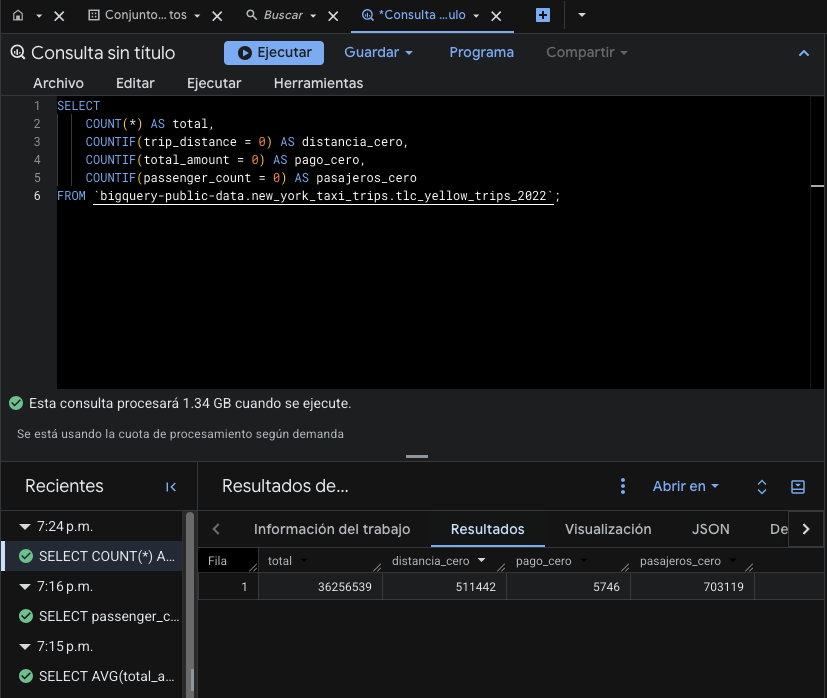

# Proyecto 2: Análisis de viajes NYC Taxi 2022 con BigQuery y Machine Learning


**Curso:** Seminario de Sistemas 2 · **Repositorio:** `SS22S2026_grupo21` · **Carpeta:** `proyectos/proyecto2`

**Integrantes:**
- Integrante 1: _(Giovanni Saul Concohá Cax y 202100229)_
- Integrante 2: _(Melvin Alexander Valencia Estrada y 202111556)_

## 1. Introducción y descripción general del proyecto

El proyecto consiste en analizar los viajes de taxis amarillos de la ciudad de Nueva York durante 2022 utilizando Google BigQuery como plataforma de almacenamiento y procesamiento de datos, SQL para la exploración y transformación de la información, BigQuery ML para la construcción y evaluación de modelos predictivos, y Looker Studio para la presentación de los resultados.

El trabajo comienza con la conexión al conjunto de datos público, la identificación de sus tablas y columnas y el análisis exploratorio de los registros disponibles. A partir de los hallazgos del análisis exploratorio, se definen criterios de limpieza, se construyen tablas derivadas y se implementan estrategias de optimización mediante particiones y clustering.

Posteriormente, se generan variables para entrenar modelos de Machine Learning y se evalúan dos tareas: la predicción del importe de la tarifa y la clasificación de viajes según si presentan una propina alta. Finalmente, los resultados se organizan en dashboards interactivos para facilitar su interpretación.

### 1.1. Objetivos

**Objetivo general**

Desarrollar un proceso reproducible de análisis de datos masivos que permita explorar, limpiar, transformar, optimizar y modelar los viajes de taxis amarillos de Nueva York correspondientes a 2022, utilizando herramientas de Google Cloud.

**Objetivos específicos**

- Conectarse al conjunto de datos público de viajes de taxi disponible en BigQuery.
- Identificar la estructura, el volumen, las variables y las características principales de los registros.
- Analizar las distribuciones temporales, geográficas, económicas y categóricas de los viajes.
- Detectar valores nulos, registros anómalos y posibles problemas de calidad.
- Construir tablas derivadas con criterios explícitos de limpieza.
- Comparar consultas sobre datos originales, tablas sin optimizar y tablas particionadas y clusterizadas.
- Crear variables para los modelos de regresión y clasificación.
- Entrenar y evaluar modelos mediante BigQuery ML, controlando la separación entre entrenamiento y evaluación.
- Presentar los principales indicadores mediante Looker Studio.

### 1.2. Alcance funcional

| Componente | Descripción | Resultado esperado |
|---|---|---|
| Conexión a datos | Acceso al conjunto público de NYC Taxi Trips. | Identificación de las tablas y validación de la fuente. |
| Análisis exploratorio (EDA) | Inspección del esquema, volumen, distribuciones y calidad. | Comprensión de los datos antes de transformarlos. |
| Limpieza y transformación | Aplicación de reglas para conservar registros válidos y crear variables derivadas. | Tablas preparadas para el análisis. |
| Optimización | Creación de tablas particionadas y clusterizadas. | Comparación de bytes procesados y rendimiento de consultas. |
| Machine Learning | Entrenamiento de modelos de regresión lineal y logística. | Predicciones y métricas de evaluación. |
| Visualización | Integración de tablas agregadas con Looker Studio. | Dashboards de análisis exploratorio y evaluación de modelos. |

### 1.3. Modelos de Machine Learning

| Modelo | Tipo | Variable objetivo | Propósito | Métricas principales |
|---|---|---|---|---|
| Modelo 1 | Regresión lineal | `fare_amount` | Estimar el importe de la tarifa del viaje, en USD. | RMSE, MAE y R². |
| Modelo 2 | Regresión logística | `tip_alta` | Clasificar si la propina representa al menos el 20 % de la tarifa. | Precision, recall, F1-score, ROC-AUC, accuracy y matriz de confusión. |

La variable `tip_alta` se construye a partir de la relación entre `tip_amount` y `fare_amount`. En términos generales, se considera positiva cuando la propina es igual o superior al 20 % de la tarifa.

Para el segundo modelo se utilizan registros de pago con tarjeta, debido a que la propina en efectivo no se registra de la misma forma que la propina pagada mediante tarjeta.

---

## 2. Conexión con Google BigQuery

### 2.1. Fuente de datos

La fuente principal es el conjunto de datos público `new_york_taxi_trips`, disponible en BigQuery bajo el proyecto público `bigquery-public-data`.

 19.17.51.png>)

La tabla principal utilizada es:

`bigquery-public-data.new_york_taxi_trips.tlc_yellow_trips_2022`

Esta tabla contiene los registros de los viajes de taxis amarillos correspondientes a 2022, incluyendo fechas de recogida y destino, distancia recorrida, cantidad de pasajeros, importes de tarifas, propinas, montos totales y códigos de ubicación.

También se utiliza la tabla geográfica `taxi_zone_geom` para relacionar los identificadores de ubicación de los viajes con los nombres de las zonas y sus distritos.

### 2.2. Consulta para descubrir las tablas disponibles

El primer paso consiste en consultar los metadatos del conjunto público mediante `INFORMATION_SCHEMA.TABLES`.

**Consulta ejecutada:**

```sql
SELECT table_name
FROM `bigquery-public-data.new_york_taxi_trips.INFORMATION_SCHEMA.TABLES`;
```

Esta consulta permite conocer las tablas disponibles sin necesidad de leer todos los registros de las tablas de viajes. Es una consulta de metadatos y sirve para identificar la fuente correcta antes de iniciar el análisis.

**Resultado obtenido:**

| N.º | Tabla | Tipo de información |
|---:|---|---|
| 1 | `tlc_yellow_trips_2023` | Viajes de taxis amarillos de 2023. |
| 2 | `tlc_yellow_trips_2016` | Viajes de taxis amarillos de 2016. |
| 3 | `tlc_green_trips_2018` | Viajes de taxis verdes de 2018. |
| 4 | `tlc_green_trips_2019` | Viajes de taxis verdes de 2019. |
| 5 | `tlc_fhv_trips_2016` | Viajes de vehículos de alquiler de 2016. |
| 6 | `tlc_yellow_trips_2014` | Viajes de taxis amarillos de 2014. |
| 7 | `tlc_green_trips_2022` | Viajes de taxis verdes de 2022. |
| 8 | `tlc_yellow_trips_2019` | Viajes de taxis amarillos de 2019. |
| 9 | `taxi_zone_geom` | Información geográfica de las zonas de taxi. |
| 10 | `tlc_yellow_trips_2017` | Viajes de taxis amarillos de 2017. |
| 11 | `tlc_yellow_trips_2012` | Viajes de taxis amarillos de 2012. |
| 12 | `tlc_green_trips_2022` | Viajes de taxis verdes de 2022. |
| 13 | `tlc_yellow_trips_2015` | Viajes de taxis amarillos de 2015. |
| 14 | `tlc_yellow_trips_2018` | Viajes de taxis amarillos de 2018. |
| 15 | `tlc_yellow_trips_2020` | Viajes de taxis amarillos de 2020. |
| 16 | `tlc_fhv_trips_2015` | Viajes de vehículos de alquiler de 2015. |
| 17 | `tlc_green_trips_2014` | Viajes de taxis verdes de 2014. |
| 18 | `tlc_yellow_trips_2022` | Viajes de taxis amarillos de 2022. |
| 19 | `tlc_green_trips_2023` | Viajes de taxis verdes de 2023. |
| 20 | `tlc_fhv_trips_2017` | Viajes de vehículos de alquiler de 2017. |
| 21 | `tlc_green_trips_2017` | Viajes de taxis verdes de 2017. |
| 22 | `tlc_yellow_trips_2011` | Viajes de taxis amarillos de 2011. |
| 23 | `tlc_green_trips_2021` | Viajes de taxis verdes de 2021. |
| 24 | `tlc_green_trips_2020` | Viajes de taxis verdes de 2020. |
| 25 | `tlc_green_trips_2016` | Viajes de taxis verdes de 2016. |
| 26 | `tlc_yellow_trips_2021` | Viajes de taxis amarillos de 2021. |
| 27 | `tlc_green_trips_2015` | Viajes de taxis verdes de 2015. |
| 28 | `tlc_yellow_trips_2013` | Viajes de taxis amarillos de 2013. |

**Interpretación**

El resultado confirma que el conjunto de datos contiene información de diferentes años y modalidades de transporte. Para este proyecto se seleccionó `tlc_yellow_trips_2022`, porque corresponde al tipo de taxi y al periodo de estudio definidos.

La tabla `taxi_zone_geom` se reserva para los análisis geográficos que requieren mostrar nombres de zonas y distritos, en lugar de trabajar únicamente con identificadores numéricos almacenados como texto.

### 2.3. Validación del esquema de la tabla

Una vez identificada la tabla principal, se consultó su estructura para conocer los nombres y tipos de datos de las columnas.

**Consulta ejecutada:**

```sql
SELECT
    column_name,
    data_type
FROM `bigquery-public-data.new_york_taxi_trips.INFORMATION_SCHEMA.COLUMNS`
WHERE table_name = 'tlc_yellow_trips_2022'
ORDER BY ordinal_position;
```

Esta consulta permite conocer la estructura de la tabla y preparar las consultas posteriores de exploración, limpieza y transformación.

 19.18.21.png>)

**Resultado obtenido:**

| N.º | Columna | Tipo de dato | Descripción funcional |
|---:|---|---|---|
| 1 | `vendor_id` | `STRING` | Identificador del proveedor del servicio. |
| 2 | `pickup_datetime` | `TIMESTAMP` | Fecha y hora de recogida. |
| 3 | `dropoff_datetime` | `TIMESTAMP` | Fecha y hora de destino. |
| 4 | `passenger_count` | `INT64` | Cantidad de pasajeros reportada. |
| 5 | `trip_distance` | `NUMERIC` | Distancia del viaje. |
| 6 | `rate_code` | `STRING` | Código de tarifa aplicado. |
| 7 | `store_and_fwd_flag` | `STRING` | Indicador de almacenamiento y reenvío del registro. |
| 8 | `payment_type` | `STRING` | Código del método de pago. |
| 9 | `fare_amount` | `NUMERIC` | Importe de la tarifa. |
| 10 | `extra` | `NUMERIC` | Cargos adicionales. |
| 11 | `mta_tax` | `NUMERIC` | Impuesto asociado a MTA. |
| 12 | `tip_amount` | `NUMERIC` | Importe de la propina registrada. |
| 13 | `tolls_amount` | `NUMERIC` | Importe de peajes. |
| 14 | `imp_surcharge` | `NUMERIC` | Recargo de mejora de infraestructura. |
| 15 | `airport_fee` | `NUMERIC` | Cargo relacionado con el aeropuerto. |
| 16 | `total_amount` | `NUMERIC` | Importe total registrado del viaje. |
| 17 | `pickup_location_id` | `STRING` | Identificador de la zona de recogida. |
| 18 | `dropoff_location_id` | `STRING` | Identificador de la zona de destino. |
| 19 | `data_file_year` | `INT64` | Año del archivo de origen. |
| 20 | `data_file_month` | `INT64` | Mes del archivo de origen. |

**Interpretación**

La estructura contiene variables temporales, numéricas, categóricas y geográficas. Esta diversidad permite realizar análisis de comportamiento, cálculos de tarifas, estudios por hora y día, análisis de rutas y construcción de modelos predictivos.

Las columnas `pickup_datetime` y `dropoff_datetime` son fundamentales para calcular la duración del viaje y extraer variables como el mes, el día de la semana y la hora de recogida.

Las variables `fare_amount`, `tip_amount` y `total_amount` permiten estudiar el comportamiento económico de los viajes. Por su parte, `pickup_location_id` y `dropoff_location_id` permiten analizar los recorridos y relacionarlos con la información geográfica.

La consulta del esquema también ayuda a evitar incompatibilidades de tipos al crear las tablas derivadas y los modelos de BigQuery ML.

### 2.4. Inspección de registros de ejemplo

Después de identificar las columnas, se consultaron algunos registros para comprobar cómo se presentan los datos y reconocer posibles anomalías.

**Consulta ejecutada:**

```sql
SELECT *
FROM `bigquery-public-data.new_york_taxi_trips.tlc_yellow_trips_2022`
LIMIT 6;
```

 19.18.58.png>)

Entre los registros obtenidos se encontró el siguiente ejemplo:

| Campo | Valor observado |
|---|---|
| `vendor_id` | `2` |
| `pickup_datetime` | `2022-03-21 11:22:21 UTC` |
| `dropoff_datetime` | `2022-03-21 11:22:33 UTC` |
| `passenger_count` | `1` |
| `trip_distance` | `0` |
| `rate_code` | `1.0` |
| `store_and_fwd_flag` | `N` |
| `payment_type` | `1` |
| `fare_amount` | `0` |
| `extra` | `0` |
| `mta_tax` | `0` |
| `tip_amount` | `0` |
| `tolls_amount` | `0` |
| `imp_surcharge` | `0` |
| `airport_fee` | `0` |
| `total_amount` | `0` |
| `pickup_location_id` | `193` |
| `dropoff_location_id` | `193` |
| `data_file_year` | `2022` |
| `data_file_month` | `3` |

**Interpretación**

La inspección evidencia que pueden existir registros con distancia y montos iguales a cero. En el ejemplo, la diferencia entre la hora de recogida y la hora de destino es de apenas unos segundos, por lo que este registro debe examinarse con criterios de calidad antes de utilizarlo para calcular promedios o entrenar modelos.

La consulta con `LIMIT` tiene como finalidad inspeccionar ejemplos y no permite establecer por sí sola qué proporción de los registros presenta anomalías. Para eso se requieren agregaciones sobre el conjunto completo.

---

## 3. Análisis exploratorio de datos (EDA)

### 3.1. Objetivo del análisis exploratorio

El análisis exploratorio de datos, o EDA por sus siglas en inglés, se realizó antes de definir las reglas de limpieza, las particiones, el clustering y los modelos de Machine Learning.

Su objetivo es conocer el comportamiento de los registros y fundamentar las decisiones técnicas con evidencia obtenida mediante SQL.

El análisis se organizó en las siguientes dimensiones:

- Volumen total de registros.
- Distribución temporal de los viajes.
- Características de distancia y duración.
- Importes y montos totales.
- Cantidad de pasajeros.
- Métodos de pago.
- Rutas más frecuentes.
- Calidad de los datos y valores extremos.

Las consultas se ejecutaron directamente sobre la tabla pública para establecer una referencia inicial de los datos originales.

### 3.2. Volumen total de viajes

Para determinar el tamaño del conjunto de datos se ejecutó una consulta de conteo sobre la tabla principal.

**Consulta ejecutada:**

```sql
SELECT
    COUNT(*) AS total_viajes
FROM `bigquery-public-data.new_york_taxi_trips.tlc_yellow_trips_2022`;
```

 19.19.19.png>)

**Resultado:**

| Indicador | Resultado |
|---|---:|
| Total de registros | 36,256,539 |
| Tabla consultada | `tlc_yellow_trips_2022` |

**Interpretación**

La tabla contiene **36,256,539 registros**, equivalentes a más de 36 millones de filas. Este volumen justifica utilizar una plataforma analítica como BigQuery y considerar estrategias de optimización para las consultas recurrentes.

Aunque el enunciado del proyecto menciona un conjunto de más de 100 millones de registros, el conteo efectuado sobre la tabla seleccionada arroja el resultado indicado. Por tanto, para describir el alcance real del análisis debe utilizarse el conteo validado de la tabla de taxis amarillos de 2022, en lugar de asumir que la tabla individual contiene 100 millones de filas.

### 3.3. Distribución mensual de los viajes

Para conocer cómo se distribuyen los viajes durante el año, se extrajo el mes de la fecha de recogida y se contó la cantidad de registros correspondiente a cada mes.

**Consulta ejecutada:**

```sql
SELECT
    EXTRACT(MONTH FROM pickup_datetime) AS mes,
    COUNT(*) AS viajes
FROM `bigquery-public-data.new_york_taxi_trips.tlc_yellow_trips_2022`
GROUP BY mes
ORDER BY mes;
```

 19.19.38.png>)

**Resultados disponibles:**

| Mes | Cantidad de viajes |
|---:|---:|
| Enero | 2,463,954 |
| Febrero | 2,979,419 |
| Marzo | 3,627,887 |


**Interpretación**

Entre enero y marzo se observa un aumento en el número de viajes registrados. Enero presenta aproximadamente 2.46 millones de viajes, febrero cerca de 2.98 millones y marzo alrededor de 3.63 millones.

Esta consulta permite identificar variaciones en la demanda mensual y proporciona una base para elaborar gráficos temporales. Para establecer cuáles son los meses de mayor y menor demanda de todo el periodo es necesario considerar la tabla completa de resultados.

### 3.4. Distribución por día de la semana

Para analizar las diferencias entre los días de la semana se agrupó la información utilizando el nombre del día derivado de `pickup_datetime`.

**Consulta ejecutada:**

```sql
SELECT
    FORMAT_DATE('%A', DATE(pickup_datetime)) AS dia,
    COUNT(*) AS viajes
FROM `bigquery-public-data.new_york_taxi_trips.tlc_yellow_trips_2022`
GROUP BY dia
ORDER BY viajes DESC;
```

**Resultados:**

| Posición | Día | Cantidad de viajes |
|---:|---|---:|
| 1 | Jueves | 5,541,019 |
| 2 | Miércoles | 5,499,048 |
| 3 | Viernes | 5,486,263 |
| 4 | Martes | 5,335,167 |
| 5 | Sábado | 5,281,407 |
| 6 | Lunes | 4,701,114 |
| 7 | Domingo | 4,412,521 |

**Interpretación**

El jueves es el día con mayor cantidad de viajes registrados, con 5,541,019. Le siguen el miércoles y el viernes. El domingo presenta el menor volumen, con 4,412,521 viajes, seguido del lunes.

Los resultados muestran diferencias en la actividad según el día de la semana. Este comportamiento puede estudiarse junto con la hora de recogida para determinar si existen periodos específicos de mayor concentración de viajes.

Los datos corresponden a conteos descriptivos y no explican por sí mismos las causas de las diferencias observadas.

### 3.5. Distribución de viajes por hora

Para identificar las variaciones de demanda a lo largo del día, se extrajo la hora de `pickup_datetime` y se contabilizaron los viajes correspondientes a cada una de las 24 horas.

**Consulta ejecutada:**

```sql
SELECT
    EXTRACT(HOUR FROM pickup_datetime) AS hora,
    COUNT(*) AS viajes
FROM `bigquery-public-data.new_york_taxi_trips.tlc_yellow_trips_2022`
GROUP BY hora
ORDER BY hora;
```

 19.20.01.png>)

**Primeros resultados disponibles:**

| Hora | Cantidad de viajes |
|---:|---:|
| 00:00 | 1,001,786 |
| 01:00 | 661,286 |
| 02:00 | 440,841 |
| 03:00 | 291,413 |
| 04:00 | 200,553 |


**Interpretación**

En los registros mostrados se observa una reducción progresiva del número de viajes entre la medianoche y las 04:00. La cantidad pasa de 1,001,786 viajes a las 00:00 a 200,553 a las 04:00.

Este comportamiento evidencia una menor actividad durante las primeras horas de la madrugada en el tramo analizado. Para identificar las horas pico del día completo se debe comparar el resultado de todas las horas, no solamente las primeras cinco.

El análisis horario también permite construir variables derivadas como `pickup_hour` e `is_rush_hour`, útiles para estudiar los patrones de demanda y entrenar los modelos predictivos.

### 3.6. Distancia de los viajes

Se calcularon la distancia promedio, la mínima y la máxima registradas para conocer la distribución inicial de `trip_distance`.

**Consulta ejecutada:**

```sql
SELECT
    AVG(trip_distance) AS distancia_promedio,
    MIN(trip_distance) AS distancia_minima,
    MAX(trip_distance) AS distancia_maxima
FROM `bigquery-public-data.new_york_taxi_trips.tlc_yellow_trips_2022`;
```


**Resultados:**

| Indicador | Resultado |
|---|---:|
| Distancia promedio | 6.077670271 |
| Distancia mínima | 0 |
| Distancia máxima | 389,678.46 |

**Interpretación**

La distancia promedio inicial es aproximadamente 6.08 unidades de distancia reportadas por la fuente. Sin embargo, el valor máximo de 389,678.46 resulta extraordinariamente elevado para un viaje convencional en taxi.

También se identifica una distancia mínima igual a cero. Estos resultados muestran que la distribución original contiene valores que deben investigarse antes de utilizar la distancia en análisis estadísticos o modelos predictivos.

La presencia de valores extremos puede distorsionar los promedios y afectar el entrenamiento de los modelos. Por esta razón, la limpieza posterior establece límites para la distancia válida.

### 3.7. Análisis de los importes pagados

Para examinar el comportamiento económico de los registros, se calcularon el monto total promedio, el mínimo y el máximo de `total_amount`.

**Consulta ejecutada:**

```sql
SELECT
    AVG(total_amount) AS promedio,
    MIN(total_amount) AS minimo,
    MAX(total_amount) AS maximo
FROM `bigquery-public-data.new_york_taxi_trips.tlc_yellow_trips_2022`;
```

**Resultados:**

| Indicador | Resultado en USD |
|---|---:|
| Monto total promedio | 21.401159324 |
| Monto total mínimo | -2,567.80 |
| Monto total máximo | 401,095.62 |

**Interpretación**

El monto total promedio inicial es aproximadamente USD 21.40. Sin embargo, el mínimo negativo y el máximo de USD 401,095.62 evidencian que existen registros con valores muy alejados de los montos habituales de un viaje.

Estos valores extremos pueden afectar el cálculo de promedios, la interpretación de los ingresos y el desempeño de los modelos de regresión.

La investigación de estos casos es necesaria para determinar qué registros deben excluirse de las tablas analíticas utilizadas posteriormente.

### 3.8. Distribución por cantidad de pasajeros

Se examinó la cantidad de viajes según el valor de `passenger_count`.

**Consulta ejecutada:**

```sql
SELECT
    passenger_count,
    COUNT(*) AS viajes
FROM `bigquery-public-data.new_york_taxi_trips.tlc_yellow_trips_2022`
GROUP BY passenger_count
ORDER BY viajes DESC;
```


**Primeros resultados disponibles:**

| Cantidad de pasajeros | Cantidad de viajes |
|---:|---:|
| 1 | 25,889,529 |
| 2 | 5,334,240 |
| 3 | 1,399,213 |


**Interpretación**

La categoría de un pasajero concentra la mayor cantidad de viajes entre los resultados mostrados, con 25,889,529 registros. La categoría de dos pasajeros ocupa el segundo lugar, con 5,334,240 viajes, seguida de tres pasajeros.

La distribución permite observar que los viajes individuales tienen una presencia importante en la fuente de datos. También justifica revisar los valores nulos, ceros y cantidades de pasajeros inusuales antes de construir las tablas limpias.

### 3.9. Calidad de los datos: distancias, pagos y pasajeros

Se realizó una revisión inicial de tres condiciones: distancia igual a cero, monto total igual a cero y cantidad de pasajeros igual a cero.

**Consulta ejecutada:**

```sql
SELECT
    COUNT(*) AS total,
    COUNTIF(trip_distance = 0) AS distancia_cero,
    COUNTIF(total_amount = 0) AS pago_cero,
    COUNTIF(passenger_count = 0) AS pasajeros_cero
FROM `bigquery-public-data.new_york_taxi_trips.tlc_yellow_trips_2022`;
```


**Resultados:**

| Indicador de calidad | Cantidad de registros |
|---|---:|
| Total de registros | 36,256,539 |
| Distancia igual a cero | 511,442 |
| Monto total igual a cero | 5,746 |
| Cantidad de pasajeros igual a cero | 703,119 |



**Interpretación**

La revisión detectó 511,442 registros con distancia igual a cero, 5,746 con monto total igual a cero y 703,119 con cantidad de pasajeros igual a cero.

Estos conteos permiten cuantificar algunas condiciones que requieren revisión durante la limpieza. Un registro con distancia cero, por ejemplo, puede corresponder a un viaje atípico o a un problema de registro. De forma similar, un conteo de pasajeros igual a cero puede indicar información faltante o un registro que no representa un viaje convencional.

Las condiciones no son necesariamente excluyentes: un mismo registro puede presentar más de una de ellas. Por tanto, no deben sumarse para estimar directamente la cantidad total de filas inválidas.

Además, esta consulta revisa únicamente las tres condiciones indicadas. No representa por sí sola una evaluación completa de nulos, duplicados, fechas inconsistentes o valores extremos.

### 3.10. Duración de los viajes

Para conocer la duración de los viajes se calculó la diferencia, en minutos, entre las fechas de recogida y destino. La consulta considera únicamente los registros cuya fecha de destino es posterior a la fecha de recogida.

**Consulta ejecutada:**

```sql
SELECT
    MIN(
        TIMESTAMP_DIFF(dropoff_datetime, pickup_datetime, MINUTE)
    ) AS min_duracion,
    AVG(
        TIMESTAMP_DIFF(dropoff_datetime, pickup_datetime, MINUTE)
    ) AS promedio,
    MAX(
        TIMESTAMP_DIFF(dropoff_datetime, pickup_datetime, MINUTE)
    ) AS max_duracion
FROM `bigquery-public-data.new_york_taxi_trips.tlc_yellow_trips_2022`
WHERE dropoff_datetime > pickup_datetime;
```


**Resultados:**

| Indicador | Resultado |
|---|---:|
| Duración mínima | 0 minutos |
| Duración promedio | 56.362017641887235 minutos |
| Duración máxima | 10,322,055 minutos |

**Interpretación**

La duración mínima es de cero minutos porque `TIMESTAMP_DIFF` devuelve la diferencia en minutos enteros; una duración positiva inferior a un minuto también puede producir un resultado de cero.

El promedio inicial de aproximadamente 56.36 minutos y, especialmente, la duración máxima de 10,322,055 minutos indican que existen registros con intervalos temporales extraordinariamente elevados.

La condición `dropoff_datetime > pickup_datetime` elimina los intervalos negativos o con fechas iguales, pero no elimina por sí misma las duraciones excesivas. Por ello, la limpieza posterior establece límites para la duración y permite calcular una variable más adecuada para el análisis y los modelos.

### 3.11. Distribución por mes del archivo de origen

Además del mes extraído de `pickup_datetime`, se revisó la distribución según el campo `data_file_month`.

**Consulta ejecutada:**

```sql
SELECT
    data_file_month,
    COUNT(*) AS viajes
FROM `bigquery-public-data.new_york_taxi_trips.tlc_yellow_trips_2022`
GROUP BY data_file_month
ORDER BY data_file_month;
```

**Primeros resultados disponibles:**

| Mes del archivo | Cantidad de viajes |
|---:|---:|
| 1 | 2,463,931 |
| 2 | 2,979,430 |
| 3 | 3,627,881 |


**Interpretación**

El campo `data_file_month` permite analizar la distribución según el mes del archivo de origen. La consulta anterior, en cambio, utiliza el mes derivado de la fecha de recogida.

Aunque ambos campos representan información mensual, sus valores no deben asumirse idénticos sin comprobarlos. En los tres meses proporcionados se observan diferencias pequeñas entre los conteos obtenidos por ambos métodos.

Esta comparación resulta útil para validar la consistencia temporal de la fuente y determinar cuál de los campos debe utilizarse en cada etapa del procesamiento.

### 3.12. Métodos de pago

Se consultó la frecuencia de los códigos registrados en `payment_type`.

**Consulta ejecutada:**

```sql
SELECT
    payment_type,
    COUNT(*) AS cantidad
FROM `bigquery-public-data.new_york_taxi_trips.tlc_yellow_trips_2022`
GROUP BY payment_type
ORDER BY cantidad DESC;
```

 19.32.30.png>)


**Resultados:**

| Posición | Código de pago | Cantidad de registros |
|---:|---:|---:|
| 1 | `1` | 27,531,946 |
| 2 | `2` | 7,102,477 |
| 3 | `0` | 1,241,840 |
| 4 | `4` | 207,844 |
| 5 | `3` | 172,427 |
| 6 | `5` | 5 |

**Interpretación**

El código `1` es el más frecuente, con 27,531,946 registros, seguido del código `2`, con 7,102,477. Los códigos restantes presentan una frecuencia considerablemente menor.

Esta distribución permite identificar la importancia de los pagos con tarjeta en la fuente y fundamenta el análisis específico de propinas registradas mediante ese método.

También muestra la presencia de registros con códigos menos frecuentes que requieren atención al definir los criterios de limpieza. La tabla derivada utilizada en el proyecto conserva los códigos de pago del 1 al 4, según las reglas establecidas para el análisis.

Los códigos se muestran inicialmente como valores originales de la fuente. Su interpretación debe mantenerse consistente con las reglas de codificación utilizadas en el proyecto.

### 3.13. Rutas más frecuentes

Para identificar los recorridos más comunes se agruparon los registros por identificador de zona de recogida y de destino.

**Consulta ejecutada:**

```sql
SELECT
    pickup_location_id,
    dropoff_location_id,
    COUNT(*) AS viajes
FROM `bigquery-public-data.new_york_taxi_trips.tlc_yellow_trips_2022`
GROUP BY
    pickup_location_id,
    dropoff_location_id
ORDER BY viajes DESC
LIMIT 20;
```

**Primeros resultados disponibles:**

| Posición | Zona de recogida | Zona de destino | Cantidad de viajes |
|---:|---:|---:|---:|
| 1 | `237` | `236` | 235,454 |
| 2 | `236` | `237` | 199,312 |
| 3 | `264` | `264` | 184,323 |

*Nota: el resultado compartido contiene las primeras tres rutas, aunque la consulta devuelve hasta 20.*

**Interpretación**

Entre los primeros resultados se observan dos rutas en sentidos opuestos entre las zonas `237` y `236`, además de una agrupación de viajes cuyo origen y destino corresponden a la zona `264`.

La identificación de rutas frecuentes permite estudiar los patrones geográficos de los desplazamientos. Sin embargo, los identificadores por sí solos no proporcionan los nombres de las zonas. Para facilitar la interpretación se utiliza posteriormente la tabla geográfica `taxi_zone_geom`.

La consulta también sirve de base para identificar combinaciones de origen y destino relevantes para las visualizaciones del dashboard.

### 3.14. Inspección de importes extremos

Para investigar los valores extremos detectados en los montos, se consultaron los 20 registros con mayor `total_amount`.

**Consulta ejecutada:**

```sql
SELECT *
FROM `bigquery-public-data.new_york_taxi_trips.tlc_yellow_trips_2022`
ORDER BY total_amount DESC
LIMIT 20;
```

**Registro extremo observado:**

| Campo | Valor |
|---|---:|
| `vendor_id` | `1` |
| `pickup_datetime` | `2022-01-07 11:36:43 UTC` |
| `dropoff_datetime` | `2022-01-07 11:47:12 UTC` |
| `passenger_count` | `1` |
| `trip_distance` | `3.3` |
| `rate_code` | `1.0` |
| `payment_type` | `4` |
| `fare_amount` | 401,092.32 |
| `extra` | 2.50 |
| `mta_tax` | 0.50 |
| `tip_amount` | 0 |
| `tolls_amount` | 0 |
| `imp_surcharge` | 0.30 |
| `airport_fee` | 0 |
| `total_amount` | 401,095.62 |
| `pickup_location_id` | `107` |
| `dropoff_location_id` | `140` |

**Interpretación**

El registro presenta un monto total de USD 401,095.62 para un recorrido de 3.3 unidades de distancia y aproximadamente 10 minutos de diferencia entre la recogida y el destino.

La tarifa base de USD 401,092.32 explica casi la totalidad del monto total, lo que evidencia un valor extraordinariamente elevado para las características registradas del viaje.

Este ejemplo confirma la necesidad de investigar y filtrar montos extremos antes de construir modelos de regresión. El objetivo de la limpieza no es modificar arbitrariamente los datos, sino definir criterios explícitos que eviten que registros atípicos dominen los resultados estadísticos.

### 3.15. Inspección de distancias extremas

También se consultaron los 20 registros con las mayores distancias reportadas.

**Consulta ejecutada:**

```sql
SELECT *
FROM `bigquery-public-data.new_york_taxi_trips.tlc_yellow_trips_2022`
ORDER BY trip_distance DESC
LIMIT 20;
```

**Primeros resultados disponibles:**

| Campo | Registro 1 | Registro 2 |
|---|---|---|
| `vendor_id` | `2` | `2` |
| `pickup_datetime` | `2022-10-28 05:19:00 UTC` | `2022-05-15 18:45:00 UTC` |
| `dropoff_datetime` | `2022-10-28 05:32:00 UTC` | `2022-05-15 18:57:00 UTC` |
| `passenger_count` | `NULL` | `NULL` |
| `trip_distance` | 389,678.46 | 357,192.65 |
| `rate_code` | `NULL` | `NULL` |
| `payment_type` | `0` | `0` |
| `fare_amount` | 12.11 | 12.46 |
| `tip_amount` | 3.42 | 4.37 |
| `total_amount` | 18.83 | 20.13 |
| `pickup_location_id` | `238` | `249` |
| `dropoff_location_id` | `140` | `137` |

**Interpretación**

Los dos registros muestran distancias extraordinariamente elevadas, aunque sus tarifas totales se encuentran por debajo de USD 21. Además, ambos tienen valores nulos en `passenger_count` y `rate_code`, y utilizan el código de pago `0`.

La inconsistencia entre las distancias y los montos registrados constituye evidencia de que es necesario validar los datos antes de utilizarlos en los modelos.

Estos ejemplos se complementan con el análisis estadístico de distancias, porque permiten inspeccionar directamente las características de los registros que ocupan los extremos de la distribución.

---

## 4. Resumen consolidado de los hallazgos del EDA

La siguiente tabla reúne los principales resultados obtenidos durante la exploración inicial.

| Dimensión | Indicador o hallazgo | Resultado | Implicación para el proyecto |
|---|---|---:|---|
| Volumen | Registros de la tabla principal | 36,256,539 | Justifica el uso de BigQuery para procesar datos masivos. |
| Tiempo | Viajes en enero | 2,463,954 | Permite estudiar la evolución mensual. |
| Tiempo | Viajes en febrero | 2,979,419 | Se observa un aumento frente a enero. |
| Tiempo | Viajes en marzo | 3,627,887 | Se observa un aumento frente a febrero. |
| Día de la semana | Día con más viajes | Jueves: 5,541,019 | Permite estudiar diferencias entre días. |
| Día de la semana | Día con menos viajes | Domingo: 4,412,521 | Muestra una distribución desigual de la demanda semanal. |
| Hora | Viajes a las 00:00 | 1,001,786 | Sirve como referencia para el análisis horario. |
| Hora | Viajes a las 04:00 | 200,553 | En los datos mostrados disminuye la actividad durante la madrugada. |
| Distancia | Promedio original | 6.077670271 | Debe interpretarse considerando los valores extremos. |
| Distancia | Mínimo original | 0 | Requiere validar los viajes sin distancia registrada. |
| Distancia | Máximo original | 389,678.46 | Evidencia valores extremos. |
| Economía | Total promedio | USD 21.401159324 | Proporciona una referencia económica inicial. |
| Economía | Total mínimo | USD -2,567.80 | Requiere investigar montos negativos. |
| Economía | Total máximo | USD 401,095.62 | Requiere investigar montos excesivos. |
| Pasajeros | Viajes con un pasajero | 25,889,529 | Es la categoría más frecuente entre las mostradas. |
| Calidad | Distancia cero | 511,442 | Debe revisarse antes del modelado. |
| Calidad | Monto total cero | 5,746 | Debe revisarse antes del modelado. |
| Calidad | Pasajeros cero | 703,119 | Debe revisarse antes del modelado. |
| Duración | Promedio original | 56.362017641887235 minutos | Requiere validación debido a la presencia de valores extremos. |
| Duración | Máximo original | 10,322,055 minutos | Evidencia intervalos temporales anómalos. |
| Pagos | Código `1` | 27,531,946 | Es la categoría más frecuente. |
| Pagos | Código `2` | 7,102,477 | Es la segunda categoría más frecuente. |
| Rutas | Zona `237` → `236` | 235,454 | Es la ruta más frecuente entre las filas mostradas. |
| Rutas | Zona `236` → `237` | 199,312 | Es la segunda ruta mostrada. |

**Conclusión del EDA**

La exploración demuestra que el conjunto de datos contiene un volumen considerable de información y permite estudiar el comportamiento temporal, económico, geográfico y operativo de los viajes. También evidencia la existencia de valores extremos, distancias nulas, montos negativos y registros con cantidades de pasajeros iguales a cero.

Estos hallazgos fundamentan la construcción de tablas limpias y la definición de reglas de validación. Asimismo, permiten seleccionar variables relevantes para los modelos de Machine Learning y diseñar visualizaciones que resuman los principales patrones del conjunto de datos.

---

## 5. Decisiones de limpieza y preparación de datos

### 5.1. Justificación de la limpieza

Las consultas exploratorias muestran que la tabla original contiene registros que pueden afectar las estadísticas y los modelos predictivos. Por ello, se definieron criterios para conservar registros compatibles con el análisis de viajes convencionales.

Las reglas se aplican en las tablas derivadas y no modifican la tabla pública original.

### 5.2. Reglas de limpieza

| Regla | Criterio utilizado | Justificación |
|---|---|---|
| Periodo de estudio | Enero a noviembre de 2022, según el borrador del proyecto. | Se indicó que diciembre contiene únicamente 117 filas residuales. Este dato debe respaldarse con el conteo correspondiente si se incorpora como evidencia definitiva. |
| Cantidad de pasajeros | Entre 1 y 6. | Excluye ceros, nulos y cantidades fuera del intervalo seleccionado para viajes convencionales. |
| Método de pago | Códigos del 1 al 4. | Excluye códigos fuera del intervalo definido para el análisis. |
| Distancia | Entre 0.1 y 100 millas. | Excluye distancias cero y valores extraordinariamente elevados. |
| Tarifa base | Entre USD 2.50 y USD 500. | Reduce la influencia de importes negativos y extremos. |
| Monto total | Mayor que cero. | Excluye registros sin un importe total positivo. |
| Duración | Entre 1 y 180 minutos. | Excluye duraciones nulas, demasiado cortas o extraordinariamente largas. |
| Velocidad promedio | Máximo de 80 mph. | Permite descartar combinaciones de distancia y duración que produzcan velocidades excesivas. |

Estos límites representan criterios operativos definidos para el proyecto. No deben interpretarse como una garantía de que todos los registros restantes sean correctos ni como una validación externa de cada viaje.


### 5.3. Variables derivadas

Durante la preparación se generan variables adicionales que facilitan el análisis temporal, económico y predictivo.

| Variable | Descripción | Utilidad |
|---|---|---|
| `trip_duration_min` | Duración del viaje en minutos. | Permite analizar tiempos de recorrido. |
| `pickup_date` | Fecha de recogida sin componente horario. | Facilita las agregaciones diarias y la partición por fecha. |
| `pickup_month` | Mes de recogida. | Permite analizar tendencias mensuales. |
| `pickup_dow` | Día de la semana codificado numéricamente. | Permite analizar patrones semanales. |
| `pickup_hour` | Hora de recogida. | Permite analizar demanda por hora. |
| `is_weekend` | Indicador de fin de semana. | Distingue entre días laborales y fines de semana según la codificación definida. |
| `is_rush_hour` | Indicador de hora pico. | Facilita el análisis de los periodos horarios seleccionados como pico. |
| `avg_speed_mph` | Velocidad promedio estimada. | Ayuda a validar combinaciones de distancia y duración. |
| `fare_per_mile` | Relación entre tarifa y distancia. | Aporta información económica para el análisis y la clasificación. |
| `tip_pct` | Relación entre propina y tarifa. | Permite analizar el porcentaje de propina. |
| `trip_key` | Identificador derivado del viaje. | Facilita la identificación técnica de registros según su definición en el script. |

La creación de estas variables transforma los campos originales en características más útiles para las consultas analíticas y los modelos de Machine Learning.

---

## 6. Organización de los scripts SQL

El proyecto separa las consultas por responsabilidad para facilitar la ejecución, el mantenimiento y la revisión de los resultados.

### 6.1. Scripts de conexión, exploración y optimización

Ubicación: `proyectos/proyecto2/nyc_taxi_2022/conexion/`

| Archivo | Responsabilidad | Resultado principal |
|---|---|---|
| `00_conexion_y_validacion.sql` | Identificar tablas, consultar el esquema y validar la fuente pública. | Confirmación de la tabla de estudio y sus características iniciales. |
| `01_eda_exploratorio.sql` | Calcular métricas descriptivas, distribuciones temporales, métodos de pago, pasajeros, rutas y condiciones de calidad. | Evidencia que fundamenta las reglas de limpieza y las decisiones técnicas. |
| `02_tablas_derivadas.sql` | Crear tablas limpias y variables derivadas. | Tablas de análisis sin optimizar y optimizadas. |
| `03_comparacion_optimizacion.sql` | Ejecutar consultas comparables sobre distintas estrategias de almacenamiento. | Comparación de bytes procesados y resultados de rendimiento. |
| `04_tablas_dashboard.sql` | Crear tablas agregadas para las visualizaciones. | Fuentes de datos preparadas para Looker Studio. |

### 6.2. Scripts de Machine Learning

Ubicación: `proyectos/proyecto2/nyc_taxi_2022/modelos/`

| Archivo | Responsabilidad | Resultado principal |
|---|---|---|
| `05_features_ml.sql` | Crear la tabla de características, variables objetivo y particiones de datos para entrenamiento y evaluación. | Tabla `ml_features`. |
| `06_modelo_regresion_lineal.sql` | Entrenar las variantes del modelo de regresión lineal. | Modelos para estimar `fare_amount`. |
| `07_modelo_regresion_logistica.sql` | Entrenar las variantes del modelo de clasificación. | Modelos para predecir `tip_alta`. |
| `08_comparacion_modelos.sql` | Evaluar los modelos con métricas comparables y generar resultados de evaluación. | Métricas para comparar los modelos. |
| `09_predicciones_nuevos_registros.sql` | Generar predicciones sobre el conjunto de prueba y ejemplos nuevos, además de agregaciones temporales. | Tablas de predicciones y seguimiento temporal. |

### 6.3. Relación entre los scripts

El flujo de trabajo sigue una secuencia de dependencias:

1. `00_conexion_y_validacion.sql` identifica y valida la fuente de datos.
2. `01_eda_exploratorio.sql` examina el contenido y la calidad de los registros.
3. `02_tablas_derivadas.sql` aplica las reglas de limpieza y crea las tablas derivadas.
4. `03_comparacion_optimizacion.sql` compara las estrategias de almacenamiento y consulta.
5. `04_tablas_dashboard.sql` genera tablas agregadas para las visualizaciones exploratorias.
6. `05_features_ml.sql` prepara las variables y los conjuntos de datos para Machine Learning.
7. `06_modelo_regresion_lineal.sql` y `07_modelo_regresion_logistica.sql` entrenan los modelos.
8. `08_comparacion_modelos.sql` calcula y compara las métricas de evaluación.
9. `09_predicciones_nuevos_registros.sql` produce predicciones y resultados temporales que pueden presentarse en el dashboard.

Esta organización permite distinguir las tareas de preparación de datos de las tareas de entrenamiento, evaluación y visualización.

---

## 7. Optimización de las tablas

### 7.1. Tablas derivadas

A partir de la exploración se crean tablas derivadas que contienen registros seleccionados mediante las reglas de limpieza.

La finalidad es separar el conjunto original de las versiones preparadas para las consultas analíticas y predictivas.

| Estrategia | Descripción | Finalidad |
|---|---|---|
| Tabla pública original | Tabla mantenida por el proveedor de los datos. | Establecer una referencia inicial. |
| Tabla limpia sin optimizar | Tabla derivada con los criterios de limpieza, sin la estrategia de partición y clustering utilizada en la versión optimizada. | Medir el comportamiento de las consultas sobre datos preparados. |
| Tabla limpia particionada y clusterizada | Tabla derivada con partición por fecha y clustering por identificadores de ubicación. | Reducir la lectura innecesaria de datos en consultas compatibles con la organización física de la tabla. |

### 7.1.1 creacion de dataset:
 20.07.06.png>)

### 7.1.2  Agregar el ID del proyecto, nombre y región (misma de dataset original)
 20.20.19.png>)

### 7.1.3  Se crea el dataSet nyc_taxi_2022

 20.23.55.png>)


### 7.1.4  Creacion de tabla:
 20.32.32.png>)

### 7.1.5 tabla sin limpiar:
 22.33.35.png>)

 22.33.59.png>)

 22.35.32.png>)

### 7.1.6 tabla limpia:
 22.45.52.png>)

### 7.1.7 Comparaciones en tabla:
 23.15.43.png>)


### 7.2. Particionamiento

La tabla optimizada utiliza `DATE(pickup_datetime)` como criterio de partición.

Esta estrategia organiza los registros por fecha y permite que BigQuery omita particiones que no necesita leer cuando las consultas filtran correctamente por un rango de fechas compatible con la columna de partición.

El particionamiento resulta especialmente útil para análisis mensuales, diarios y temporales, así como para evaluaciones de modelos restringidas a determinados periodos.

### 7.3. Clustering

La tabla optimizada utiliza los campos:

- `pickup_location_id`
- `dropoff_location_id`

El clustering organiza los datos en función de estas columnas para favorecer consultas que filtran por las zonas de origen y destino.

Esta estrategia resulta útil para el análisis de rutas, la comparación de zonas y las consultas geográficas que utilizan los identificadores de ubicación.

Los beneficios dependen de las consultas ejecutadas y de sus filtros. El clustering no garantiza por sí solo una reducción de bytes para cualquier consulta.

 23.17.55.png>)


### 7.4. Comparación de rendimiento

El script `03_comparacion_optimizacion.sql` compara consultas equivalentes sobre la fuente pública, la tabla limpia sin optimizar y la tabla limpia particionada y clusterizada.

La comparación permite observar el efecto de las decisiones de almacenamiento en el volumen de datos procesados y en el rendimiento reportado por BigQuery.

| Estrategia | Qué se evalúa | Evidencia esperada |
|---|---|---|
| Tabla pública original | Consulta directa sobre la fuente pública. | Bytes procesados y tiempo de ejecución reportado. |
| Tabla limpia sin optimizar | Consulta sobre datos derivados y limpiados. | Bytes procesados y tiempo de ejecución reportado. |
| Tabla limpia particionada y clusterizada | Consulta sobre la tabla optimizada. | Bytes procesados y tiempo de ejecución reportado. |

Los resultados concretos de cada consulta deben documentarse a partir de los valores registrados durante la ejecución del benchmark. No se deben asumir reducciones de costo o tiempo sin verificar los datos reportados por BigQuery.

  23.23.02.png>)

---

## 8. Preparación para Machine Learning

### 8.1. Tabla de características

El script `05_features_ml.sql` prepara la tabla `ml_features`, que reúne las variables necesarias para entrenar los modelos.

Esta etapa utiliza los datos limpios y crea las variables objetivo, además de separar los registros según la estrategia de entrenamiento y evaluación.

### 8.2. Modelo de regresión lineal

El primer modelo busca predecir `fare_amount`.

Entre las características consideradas se encuentran:

| Variable | Función |
|---|---|
| `trip_distance` | Distancia recorrida. |
| `trip_duration_min` | Duración del viaje. |
| `pickup_hour` | Hora de recogida. |
| `pickup_dow` | Día de la semana. |
| `passenger_count` | Cantidad de pasajeros. |
| `pickup_location_id` | Zona de recogida. |
| `dropoff_location_id` | Zona de destino. |
| `rate_code` | Código de tarifa. |
| `is_weekend` | Indicador de fin de semana. |
| `is_rush_hour` | Indicador de hora pico. |

La variable objetivo es `fare_amount`. Los campos que representan componentes de la tarifa total o que podrían revelar directamente información del resultado se excluyen de las características del modelo según la definición del script.

### 8.3. Modelo de regresión logística

El segundo modelo busca clasificar si la propina es alta mediante la variable `tip_alta`.

Además de las variables temporales, geográficas y operativas, se utilizan características económicas como `fare_amount` y `fare_per_mile`.

La clasificación se restringe a registros con pago mediante tarjeta (`payment_type = '1'`) y una etiqueta disponible. Las variables que revelan directamente el importe o el porcentaje real de la propina se excluyen de las características predictoras para reducir el riesgo de *data leakage*.

### 8.4. Separación temporal y aleatoria

El proyecto compara dos estrategias de entrenamiento:

| Estrategia | Descripción | Propósito |
|---|---|---|
| Aleatoria | Divide los datos de manera aleatoria según la configuración del modelo. | Establecer una referencia de rendimiento bajo una partición aleatoria. |
| Temporal | Utiliza periodos cronológicos diferenciados para entrenamiento, evaluación y prueba. | Evaluar el comportamiento del modelo frente a un periodo posterior al entrenamiento. |

En la configuración temporal del proyecto se utilizan enero a septiembre para entrenamiento, octubre para evaluación y noviembre para prueba, según la asignación definida en la preparación de los datos.

En cambio, las variantes aleatorias utilizan una división aleatoria de los registros de enero a octubre. La comparación entre estrategias debe considerar esta diferencia, ya que cada una evalúa un escenario distinto.

---

## 9. Visualización de los resultados

Los resultados se presentan mediante Looker Studio utilizando tablas agregadas generadas en BigQuery.

El proyecto cuenta con dos dashboards principales y documentos especializados que explican su construcción e interpretación.

| Documento | Contenido |
|---|---|
| `proyectos/proyecto2/Documentacion/modelos.md` | Documentación de la construcción, evaluación e interpretación de los modelos de Machine Learning. |
| `proyectos/proyecto2/Documentacion/Dashboad.md` | Documentación de la conexión con Looker Studio, las fuentes de datos y las visualizaciones de los dashboards. |
| `proyectos/proyecto2/Documentacion/Comparacion.md` | Documentación de la comparación de estrategias de procesamiento, optimización y resultados de los modelos, según el contenido desarrollado en ese archivo. |

### 9.1. Dashboard de análisis exploratorio

El dashboard exploratorio presenta indicadores generales, distribución de métodos de pago, evolución mensual, zonas de mayor demanda, patrones temporales y comportamiento de las propinas.

Las fuentes de datos se construyen mediante `04_tablas_dashboard.sql`.

Dashboard

https://datastudio.google.com/reporting/1221f7b0-defd-4309-ab2e-fbeef7b0ef53

### 9.2. Dashboard de evaluación de Machine Learning

El dashboard de evaluación compara el volumen de datos procesados, las métricas de regresión, la curva ROC, las métricas de clasificación y el comportamiento temporal de las predicciones.

Las tablas de seguimiento temporal y de curva ROC se generan a partir de los resultados de evaluación y predicción de los modelos.

La explicación detallada de las visualizaciones, sus campos y su interpretación se encuentra en `Documentacion/Dashboad.md`.

---

## 10. Consideraciones y limitaciones

Durante la interpretación de los resultados se deben considerar los siguientes aspectos:

- **Volumen de datos:** la tabla principal contiene 36,256,539 registros según el conteo ejecutado. Este valor debe diferenciarse de la cantidad total que pueda existir en otros años o modalidades de taxi.
- **Resultados parciales:** algunas tablas presentadas en esta documentación contienen únicamente las primeras filas del resultado original. Para elaborar conclusiones sobre el conjunto completo se debe consultar el resultado íntegro.
- **Valores extremos:** las distancias, tarifas, montos y duraciones anómalas identificadas requieren limpieza antes de interpretar los promedios o entrenar modelos.
- **Criterios de limpieza:** los límites aplicados representan decisiones técnicas del proyecto y deben mantenerse documentados para que el proceso sea reproducible.
- **Métodos de pago:** el análisis de propinas con tarjeta no representa necesariamente el comportamiento de las propinas en efectivo.
- **Evaluación de modelos:** las métricas deben compararse considerando la estrategia de partición y el conjunto de datos sobre el que se calcularon.
- **Optimización:** el beneficio del particionamiento y del clustering debe justificarse con evidencia de las consultas ejecutadas.
- **Visualizaciones:** los dashboards presentan agregaciones de los datos y no sustituyen la inspección de registros individuales cuando se investigan anomalías.

---

## 11. Conclusiones generales

La conexión con BigQuery permitió identificar la fuente de datos, conocer su estructura y cuantificar el volumen de información disponible para el análisis de los viajes de taxis amarillos de Nueva York durante 2022.

El análisis exploratorio permitió identificar patrones temporales, categorías de pago frecuentes, rutas recurrentes y características económicas de los viajes. También detectó registros con distancias, importes y duraciones extremas, así como cantidades de pasajeros iguales a cero. Estos hallazgos justificaron la definición de reglas de limpieza antes de utilizar los datos para el modelado.

A partir de esta preparación, el proyecto incorpora tablas derivadas, estrategias de particionamiento y clustering, variables para Machine Learning y procedimientos de evaluación. Finalmente, los resultados se integran en dashboards que permiten consultar los principales indicadores sin necesidad de revisar individualmente todas las filas del conjunto de datos.

La organización del proyecto en scripts SQL y documentos especializados facilita la reproducibilidad, el mantenimiento y la revisión de cada etapa. De esta forma, el trabajo abarca desde la comprensión inicial de los datos hasta la presentación de resultados analíticos y predictivos mediante herramientas de Google Cloud.